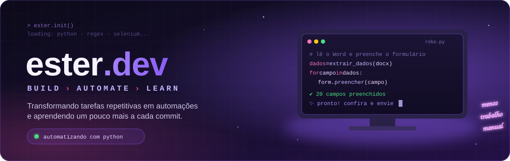

<!-- TROCAR: em todo este arquivo, troque SEU-USUARIO pelo seu usuário do GitHub -->

  

## 💜 Sobre mim

<table>
  <tr>
    <td width="42%" valign="top">
      <h3>Oi, eu sou a Ester 👋</h3>
      

        Analista financeira que aprendeu a programar resolvendo problemas do próprio trabalho.
        Uso <b>Python</b> para transformar tarefas repetitivas em automações.
      

      

        Aqui você encontra os projetos que estou construindo e o que aprendo no caminho,
        sempre explicado do jeito mais simples possível.
      

    </td>
    <td width="30%" valign="top">
       
      🟣 Automatizando com <b>Python</b>  
      🟣 Estudando <b>Django</b> e back-end  
      🟣 Criando ferramentas <b>web</b>  
      🌱 Escrevendo guias para quem está começando
    </td>
    <td width="28%" align="center">
      
    </td>
  </tr>
</table>

## ⚡ Tech Stack

  

## 🚀 Projetos

<table>
  <tr>
    <td width="50%" valign="top">
      <h3>🤖 Robô de formulários</h3>
      
Lê um documento Word, encontra cada dado com <b>regex</b> e preenche sozinho um formulário web com <b>Selenium</b>. Eu só confiro e envio.

      

        
        
        
      

      <!-- TROCAR: nome do repositório -->
      <a href="https://github.com/SEU-USUARIO/robo-formularios"><b>→ Ver projeto</b></a>
    </td>
    <td width="50%" valign="top">
      <h3>📖 Python para Automação</h3>
      
Guia que explica Python, regex e automação do jeito mais simples possível, com exemplos reais e <b>15 exercícios</b> com gabarito.

      

        
        
        
      

      <!-- TROCAR: nome do repositório -->
      <a href="https://github.com/SEU-USUARIO/python-automacao"><b>→ Ler o guia</b></a>
    </td>
  </tr>
</table>

## 📫 Onde me encontrar

  <!-- TROCAR: seus links -->
  
  
  

  ✦ feito com 💜 e um pouco de café ✦

